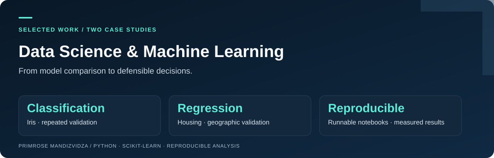

**[01 · Iris classification](task_1_iris/README.md)** &nbsp; / &nbsp; **[02 · Housing prediction](task_2_housing/README.md)** &nbsp; / &nbsp; **[Reproduce the analysis](REPRODUCIBILITY.md)**

# Evidence before model selection

Two case studies in Python data analysis and machine learning, with baseline comparisons, validation beyond a single test score, and explicit decisions about what the evidence supports.

**Focus:** reproducible workflows · model evaluation · error analysis · decision-making

## Explore the projects

| Project | Question | Evidence |
|---|---|---|
| **[Iris species classification](task_1_iris/README.md)** | How do Logistic Regression and a small Decision Tree compare on flower classification? | 150 observations; majority-class baseline; 50 training-only validation splits; confusion matrices. |
| **[California housing value prediction](task_2_housing/README.md)** | Do engineered features and regularisation improve linear-model predictions? | 17,000 census areas; median baseline; random and geographic validation; RMSE/MAE/R²; price-band errors. |

**Key findings:** Iris Logistic Regression averaged 96.0% accuracy across repeated training validation, compared with 95.1% for the tree, despite the tree winning on the small original test split. Housing's original-feature Linear Regression had lower RMSE than engineered features in both random and geographic validation. A small test-set gain alone would have led to a different, less well-supported model choice.

## Reproduce the results

Validated with **Python 3.12**. Clone the repository, then run these commands from its root:

```bash
python -m venv .venv
# macOS / Linux:
source .venv/bin/activate
# Windows PowerShell instead: .venv\Scripts\Activate.ps1
python -m pip install -r requirements.txt
python scripts/reproduce.py
```

The runner executes each notebook's Python cells in a **fresh process**, saves an executed notebook, charts, and CSV results in each project's `results/` directory, and checks the measured metrics against the recorded results. It requires no Jupyter server. It stops on a failed cell or metric mismatch. This runner supports the ordinary Python used here; it is not a general IPython-magic executor.

To run one project:

```bash
python scripts/reproduce.py --project iris
python scripts/reproduce.py --project housing
```

Iris data ships with scikit-learn. Housing requires the exact CSV linked in its [dataset instructions](task_2_housing/README.md#dataset-and-provenance), downloaded automatically on first run; later runs work offline with the cached file. If that download is blocked, download it manually and set `HOUSING_CSV` as described there. No paid service, credentials, or personal data is needed.

For interactive exploration, use the **Open in Colab** link on either project page, then **Runtime → Run all**. Colab's package versions may differ from the pinned local environment; local reproduction is the version-controlled reference.

## Repository guide

```text
task_1_iris/       Project page, notebook, measured results and charts
task_2_housing/    Project page, notebook, measured results and charts
scripts/          Automated notebook-cell execution and result checks
requirements.txt  Pinned direct dependencies
REPRODUCIBILITY.md Validation record, environment and interpretation limits
```

## Context and attribution

These educational projects were completed for Datheon Machine Learning & Data Science internship tasks. I hold a BSc Honours Degree in Information Systems from Midlands State University (2019). No production deployment or measured business impact is claimed.

## Reading the evidence

- The notebooks explain data preparation, splits, models, and limitations in sequence.
- All reported measurements come from these notebooks. A small held-out benchmark is not a guarantee of future performance.
- The data sources are credited on each project page. I did not collect either dataset.
- These projects use standard scikit-learn algorithms and public datasets. They demonstrate an applied learning workflow; they do not claim original algorithms or independent data collection.
- The notebooks are preserved at their original paths so existing links continue to work. The portfolio packaging, portable housing loader, saved evidence, and reproduction runner were added on 26 October 2026.

[LinkedIn](https://www.linkedin.com/in/primmandy/)
