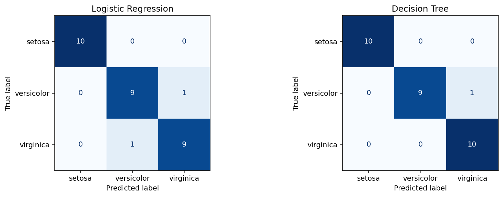

# Iris Species Classification

**Question:** Can four flower measurements distinguish three Iris species, and how do two simple classifiers compare?

[Read the notebook](Task_1_Iris_Classification.ipynb) · [Open in Colab](https://colab.research.google.com/github/primrosemandy93-maker/Datheon_Machine_Learning_-_Data_Science_Internship/blob/main/task_1_iris/Task_1_Iris_Classification.ipynb) · [Back to portfolio](../README.md)

## Work demonstrated

An educational Datheon internship task. The notebook inspects missing values and feature relationships, creates a stratified split, fits preprocessing inside pipelines, compares models, and interprets errors. This demonstrates a basic classification workflow, not a novel algorithm or deployed application.

## Data and method

- **Source:** scikit-learn's built-in [Iris dataset](https://scikit-learn.org/stable/modules/generated/sklearn.datasets.load_iris.html); 150 observations, four measurements in centimetres, three equally represented species. Dataset metadata and attribution are available through `load_iris().DESCR`.
- **Quality:** no missing values in the loaded data.
- **Split:** 120 training / 30 test observations, `test_size=0.20`, `random_state=42`, stratified by species.
- **Models:** StandardScaler → Logistic Regression (`max_iter=1000`); StandardScaler → Decision Tree (`max_depth=3`). Scaling is unnecessary for the tree but retained from the original shared pipeline design. Preprocessing is fitted on training rows only.
- **Evaluation:** accuracy plus macro-averaged precision, recall and F1. Each test species has 10 observations.

## Measured results

| Model | Accuracy | Macro precision | Macro recall | Macro F1 | Correct / test flowers |
|---|---:|---:|---:|---:|---:|
| Logistic Regression | 0.933 | 0.933 | 0.933 | 0.933 | 28 / 30 |
| Decision Tree | 0.967 | 0.970 | 0.967 | 0.967 | 29 / 30 |

[Download the exact metrics](results/metrics.csv)



**Interpretation:** the tree makes one fewer error on this split. One flower changes accuracy by 3.3 percentage points, so this does not establish that the tree is generally superior. Both models separate setosa well; the remaining errors involve versicolor and virginica.

## Limitations and next investigation

This is a small, balanced, well-known benchmark with one held-out split. There is no external validation, deployment, or real-world impact measurement. Repeated stratified cross-validation would be a useful next comparison; it has not been performed here. The [decision-boundary illustration](results/decision_boundaries.png) uses **separately fitted two-feature models**, while the table above evaluates four-feature models.

## Run it

From the repository root, install [requirements](../requirements.txt), then:

```bash
python scripts/reproduce.py --project iris
```

No dataset download is needed. The runner writes fresh tables, figures and `results/executed.ipynb`, and checks the expected accuracy and macro F1. Full environment and validation details are in [REPRODUCIBILITY.md](../REPRODUCIBILITY.md).
