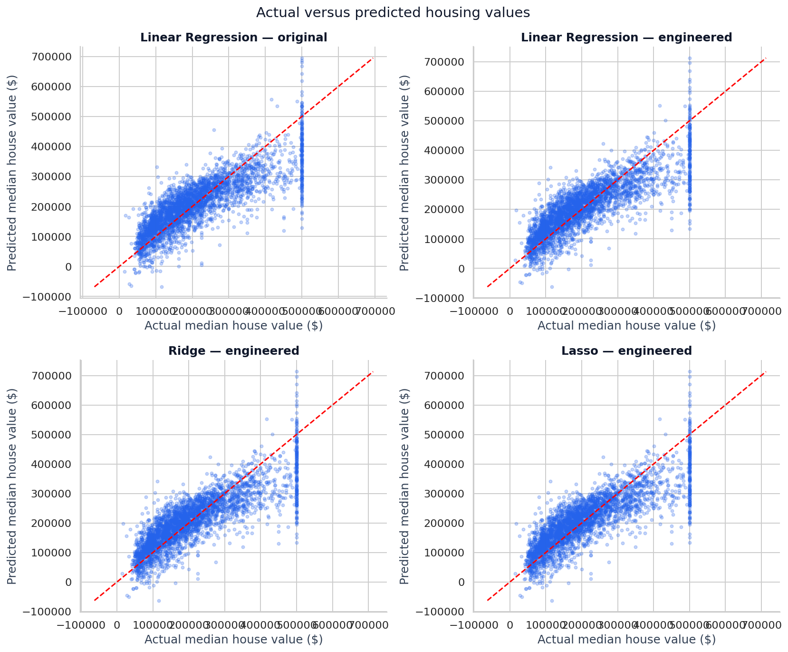
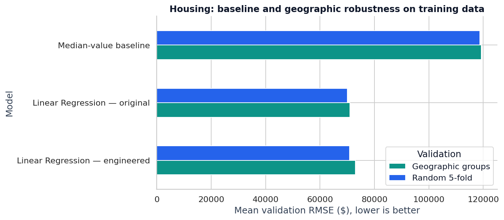

# California Housing Value Prediction

**Question:** Do feature engineering and regularisation improve predictions of historical median housing values?

[Read the notebook](Task_2_Housing_Price_Prediction.ipynb) · [Open in Colab](https://colab.research.google.com/github/primrosemandy93-maker/Datheon_Machine_Learning_-_Data_Science_Internship/blob/main/task_2_housing/Task_2_Housing_Price_Prediction.ipynb) · [Back to portfolio](../README.md)

## Scope and approach

An educational Datheon internship task. The notebook separates a test set, explores training data, engineers ratios and an interaction, compares feature sets with cross-validation, tunes Ridge and Lasso, and examines overall and price-band errors. The portfolio update adds portable data loading, saved evidence and a reproducible runner.

## Dataset and provenance

- **Source:** the 17,000-row California housing training CSV used in Google's [validation and test sets exercise](https://github.com/google/eng-edu/blob/main/ml/cc/exercises/validation_and_test_sets.ipynb), also distributed with Colab sample data.
- **[Download the exact CSV](https://download.mlcc.google.com/mledu-datasets/california_housing_train.csv)**. The notebook downloads this file if a local copy or Colab sample is unavailable. Raw data is not committed to this repository.
- **SHA-256:** `bb9ca4041a66e0ed691cb825188f16fdab518435c4950a080951be2fdfe30d4d`.
- **Shape:** 17,000 rows, eight original inputs and target `median_house_value`. Each row represents an historical census block group, **not an individual house**. Values are historical US dollars, with an upper cap visible at $500,001.
- Inputs are longitude, latitude, housing median age, total rooms, total bedrooms, population, households and median income. The income field uses the source dataset's scaled income units.
- This project holds out 20% of this training CSV. It **does not use** the separate 3,000-row Google test CSV. Do not substitute `fetch_california_housing()`; that is a different 20,640-row representation and will not reproduce these results.

If automatic downloading is blocked, save the linked CSV locally and set an absolute path:

```bash
# macOS / Linux:
export HOUSING_CSV=/absolute/path/california_housing_train.csv
# Windows PowerShell instead:
# $env:HOUSING_CSV = 'C:\path\california_housing_train.csv'
python scripts/reproduce.py --project housing
```

The loader rejects a different checksum rather than silently reporting incomparable results.

## Method

1. Split into **13,600 training / 3,400 test** areas with `random_state=42`. Explore correlations on training data only.
2. Add rooms per household, bedrooms per room, population per household, and median income × rooms per household. Zero denominators become missing values.
3. Fit median imputation, StandardScaler, and Linear Regression inside pipelines. Compare original versus engineered inputs with identical shuffled five-fold splits (`random_state=42`). The feature formulas are row-wise and learn no statistics from the test set.
4. Tune Ridge and Lasso on training data only with the same folds and `alpha ∈ {0.01, 0.1, 1, 10, 100}`. Both select 0.01. Use one worker for predictable resource use.
5. Report test RMSE, MAE, R², residuals, and MAE grouped by **observed** price band. These groups are diagnostic, not inputs to a model.

## Measured results: validation comes first

| Linear Regression inputs | Mean validation RMSE | Fold standard deviation |
|---|---:|---:|
| Original features | $70,049.11 | $1,859.51 |
| Engineered features | $70,805.39 | $5,178.29 |

**Feature engineering worsened cross-validation error and stability.** The fold standard deviation describes variation across these five folds; it is not a confidence interval.

| Model | Test RMSE | Test MAE | Test R² |
|---|---:|---:|---:|
| Linear Regression — original | $68,078.33 | $49,983.48 | 0.664 |
| Linear Regression — engineered | $67,358.06 | $49,219.45 | 0.671 |
| Ridge — engineered | $67,358.06 | $49,219.44 | 0.671 |
| Lasso — engineered | $67,358.06 | $49,219.45 | 0.671 |

**Interpretation:** engineered features reduced test RMSE by about 1.1%, but the validation evidence is worse. Treat this as mixed evidence, not a robust improvement. The original-feature model is the more defensible choice based on validation. Regularisation adds no meaningful test improvement here. R² is not classification accuracy.

[Exact test metrics](results/metrics.csv) · [Cross-validation measurements](results/cross_validation.csv) · [Price-band errors](results/errors_by_price_band.csv)



## Robustness check: baseline and geographic validation

The following comparisons use **training data only**. The baseline predicts the training-fold median for every validation area. Geographic GroupKFold holds out complete 0.5-degree latitude/longitude grid cells; code checks that grid-cell groups do not overlap within a fold.

| Model | Random 5-fold mean RMSE | Geographic mean RMSE | Geographic RMSE fold SD |
|---|---:|---:|---:|
| Median-value baseline | $118,777.82 | $119,252.62 | $12,656.14 |
| Linear Regression — original | $70,049.11 | $71,041.27 | $9,386.73 |
| Linear Regression — engineered | $70,805.39 | $73,000.11 | $9,783.02 |



[Summary measurements](results/geographic_validation.csv) · [All validation-fold measurements](results/geographic_validation_folds.csv)

**Model choice and metric trade-off:** both linear models improve substantially over the median baseline. The original features remain preferable if RMSE is the decision criterion, because RMSE gives more weight to large errors. Engineered features have lower mean MAE in both validation schemes, so the answer depends on whether typical or large errors matter more. Reporting only the favourable test metric would hide this trade-off.

Adjacent grid cells can still be near each other across folds. This is a spatial robustness check, not a geographic buffer or a claim of performance in a completely new region. Grouped fold variability is not a confidence interval.

## Where predictions struggle

For engineered Linear Regression:

| Actual median value band | Test areas | MAE |
|---|---:|---:|
| Below $150,000 | 1,252 | $42,722.99 |
| $150,000 to below $300,000 | 1,474 | $36,179.36 |
| $300,000 and above | 674 | $89,805.01 |

Higher-value areas have the largest dollar errors; this does not establish the largest percentage errors. The original notebook's “Above $300k” label includes exactly $300,000 because its bins are left-closed.

## Limitations and next investigation

Historical, capped area-level values cannot support current property valuation. Random splits can put nearby areas in both sets; the added grid-based check reduces group overlap but does not fully remove spatial dependence. Unconstrained linear predictions can also be negative, as visible in the plots. The test set has already been inspected across several variants and should not be repeatedly reused to select future models. There is no deployment or business-impact measurement. Further work would use a new untouched region or time-based holdout, examine outlying ratios and individual engineered features, and consider target constraints; that work is not claimed here.

## Run it

From the repository root, install [requirements](../requirements.txt), then:

```bash
python scripts/reproduce.py --project housing
```

The runner executes the actual notebook cells, exports results and checks the recorded metrics. See [REPRODUCIBILITY.md](../REPRODUCIBILITY.md) for the validation record and environment.
